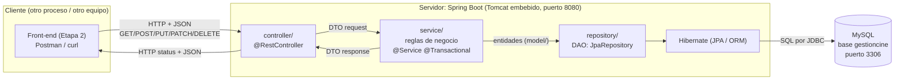
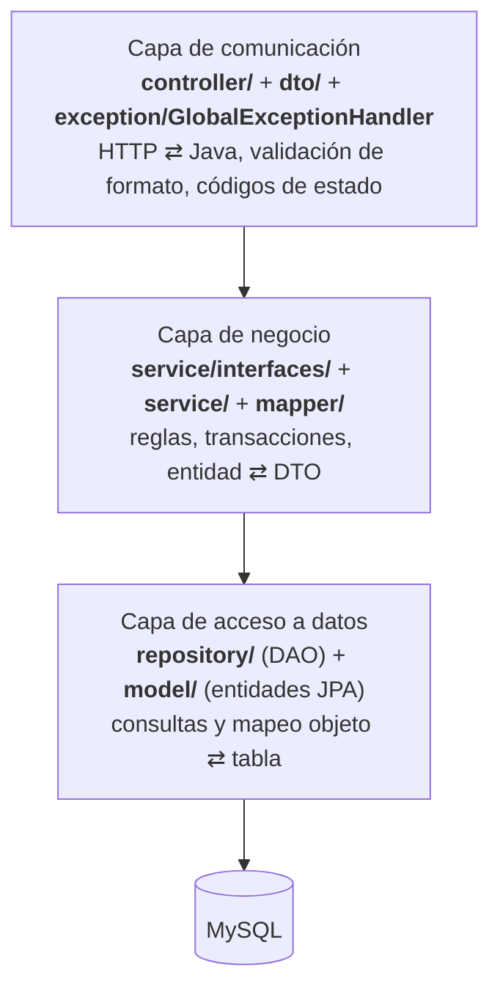
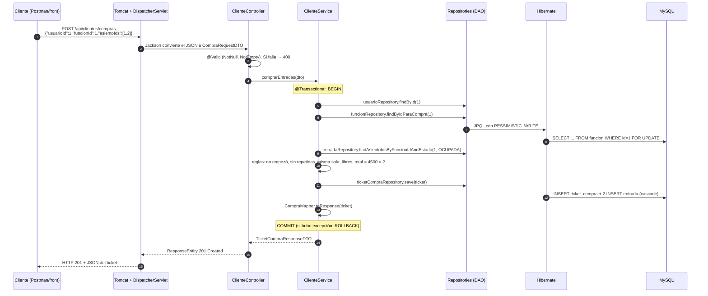

# Arquitectura

## 1. Vista general: cliente / servidor

Son **tres procesos independientes** que se comunican por red:
- El **cliente** habla HTTP con el servidor.
- El **servidor** habla SQL (JDBC sobre TCP) con **MySQL**.

El cliente nunca toca la base. Puede estar en otra máquina con solo cambiar la URL a la que apunta.

## 2. Capas y responsabilidades

| Capa | Paquetes | Hace | No hace |
|---|---|---|---|
| Comunicación (HTTP) | `controller`, `dto`, `exception` | Recibe el request, convierte el JSON a DTO, valida con `@Valid`, llama al service y arma el `ResponseEntity` con el código correcto. Traduce excepciones a HTTP | Reglas de negocio, acceso a la base |
| Negocio | `service`, `service/interfaces`, `mapper` | Aplica todas las reglas (butaca ocupada, superposición, total), abre las transacciones y convierte entidades a DTO | Saber de HTTP (no conoce `ResponseEntity` ni códigos) ni escribir SQL |
| Acceso a datos | `repository`, `model` | Consultas (derivadas del nombre del método, `@Query` en JPQL), mapeo de clases a tablas | Decidir si una operación está permitida |
| Configuración | `config`, `application.properties` | CORS, conexión, puerto | — |

Cada capa solo conoce a la de abajo. El controller no importa ningún repository y el repository no sabe que existe HTTP.

## 3. Recorrido completo de un request: `POST /api/clientes/compras`

Si en el paso 9 la butaca ya está ocupada, el service lanza `BusinessException`. La transacción hace ROLLBACK, la excepción sube hasta `GlobalExceptionHandler` y el cliente recibe **409** con el formato de error estándar.

## 4. Responsabilidad de cada clase

| Clase | Capa | Responsabilidad |
|---|---|---|
| `GestionDeCineApplication` | Arranque | `main`. `@SpringBootApplication` levanta Tomcat, escanea los componentes y configura JPA |
| `config/CorsConfig` | Configuración | Permite que el front, servido desde otro origen, llame a `/api/**`. Lee los orígenes de `cors.allowed-origins` |
| `controller/PeliculaController` | Comunicación | CRUD de `/api/peliculas` |
| `controller/SalaController` | Comunicación | CRUD de `/api/salas` y `GET /api/salas/{id}/asientos` |
| `controller/AsientoController` | Comunicación | CRUD de `/api/asientos` |
| `controller/FuncionController` | Comunicación | CRUD de `/api/funciones`, filtros, `/butacas` y `/asientos-disponibles` |
| `controller/UsuarioController` | Comunicación | CRUD de `/api/usuarios` y `/login` |
| `controller/MembresiaController` | Comunicación | Alta y baja de `/api/membresias` |
| `controller/ClienteController` | Comunicación | Cartelera, compra, cancelación, historial y membresía del cliente |
| `dto/*RequestDTO` (Pelicula, Sala, Asiento, Funcion, Usuario, Membresia, Compra, Login) | Comunicación | Forma del JSON que **entra**, con sus anotaciones de validación |
| `dto/*ResponseDTO` (Pelicula, Sala, Asiento, Funcion, Usuario, Membresia, TicketCompra, Entrada) y `ButacaDTO` | Comunicación | Forma del JSON que **sale**. Sin password ni entidades anidadas |
| `dto/ErrorResponseDTO` | Comunicación | Formato único de error |
| `exception/GlobalExceptionHandler` | Comunicación | `@RestControllerAdvice`: convierte cada excepción en un código HTTP + `ErrorResponseDTO` |
| `exception/ResourceNotFoundException` | Negocio | "No existe" → 404 |
| `exception/BusinessException` | Negocio | "Una regla lo impide" → 409 |
| `exception/AutenticacionException` | Negocio | "Credenciales incorrectas" → 401 |
| `service/interfaces/I*Service` (7) | Negocio | Contrato de cada service. Los controllers dependen de la interfaz |
| `service/PeliculaService` | Negocio | CRUD y "no borrar con funciones" |
| `service/SalaService` | Negocio | Nombre único, capacidad vs. butacas, borrado seguro |
| `service/AsientoService` | Negocio | Ubicación única, capacidad de la sala, borrado seguro |
| `service/FuncionService` | Negocio | Superposición, fecha futura, mapa de butacas por función |
| `service/UsuarioService` | Negocio | Registro como CLIENTE, mail/DNI únicos, login |
| `service/MembresiaService` | Negocio | Alta y baja de membresía y la marca `isSocio` |
| `service/ClienteService` | Negocio | **Compra** (con bloqueo), cancelación, historial, cartelera |
| `mapper/*Mapper` (Pelicula, Sala, Asiento, Funcion, Usuario, Membresia, Compra) | Negocio | Conversión manual entidad ⇄ DTO con métodos estáticos |
| `model/Pelicula, Sala, Asiento, Funcion, Usuario, Membresia, TicketCompra, Entrada` | Datos | Entidades JPA: cada una mapea a una tabla |
| `model/Rol, EstadoCompra, EstadoEntrada, FormatoFuncion, TipoMembresia` | Datos | Enums guardados como texto (`ENUM` en MySQL) |
| `repository/*Repository` (8) | Datos | DAO de cada entidad (`JpaRepository`), más consultas propias |

## 5. MVC en este proyecto

| Parte de MVC | Dónde está | Por qué |
|---|---|---|
| **Model** | `model/` (entidades) junto con `service/` y `repository/` | Los datos y las reglas del dominio |
| **Controller** | `controller/` | Recibe la acción del usuario (un request HTTP), llama al modelo y elige la respuesta |
| **View** | **No está en este repositorio.** En la API, lo más parecido a la vista es el **JSON** (los DTOs de response). La vista real es el **front-end de la Etapa 2** | Es una arquitectura cliente-servidor: la vista corre en el navegador, en otro proceso |

**¿Por qué la View no accede a la base?**
- **Seguridad:** el navegador del usuario tendría las credenciales de MySQL.
- **Reglas:** se saltearían todas las reglas del service (cualquiera podría insertar una entrada en una butaca ocupada).
- **Acoplamiento:** cambiar una columna rompería el front.
- **Red:** MySQL no habla HTTP y no debería estar expuesto a Internet.

La vista solo conoce la API y sus contratos JSON.

## 6. Patrones de diseño usados

| Patrón | Problema que resuelve | Dónde está | Alternativa |
|---|---|---|---|
| **Arquitectura en capas** | Mezclar HTTP, reglas y SQL hace el código imposible de mantener y de testear | Paquetes `controller` → `service` → `repository` | Todo en el controller (ver PREGUNTAS_DEFENSA) |
| **MVC** | Separar la entrada (controller), los datos y reglas (model) y la presentación (view) | §5 | — |
| **DAO / Repository** | Aislar *cómo* se guardan los datos del resto del código | `repository/*Repository extends JpaRepository` | Escribir a mano clases DAO con JDBC y SQL (`PreparedStatement`) |
| **DTO** | No exponer las entidades: evita filtrar datos (password), recursión infinita en JSON, consultas LAZY fuera de la transacción y acoplar el JSON a las tablas | `dto/` | Devolver la entidad con `@JsonIgnore` (frágil, mezcla responsabilidades) |
| **Service Layer** | Un único lugar para las reglas y las transacciones, reutilizable desde cualquier controller o test | `service/` + `service/interfaces/` | Reglas en controllers o en triggers de la base |
| **Mapper** | La conversión entidad ⇄ DTO no debe repetirse en cada método | `mapper/` | MapStruct o ModelMapper (librerías, fuera del stack permitido) |
| **Inyección de dependencias (por constructor)** | Las clases no crean sus dependencias con `new`: Spring se las pasa. Se pueden reemplazar por mocks en los tests | Todos los constructores de controllers y services | `@Autowired` sobre el atributo (oculta dependencias, no permite `final`) o `new` (acopla y no se puede testear) |
| **Singleton (beans de Spring)** | Un controller o service no tiene estado propio por request: alcanza con una sola instancia compartida | Todo `@Service`, `@RestController`, `@Repository` y `@Configuration` (scope singleton por defecto) | Crear una instancia por request (desperdicio) |
| **Proxy** | Agregar comportamiento sin tocar la clase | Spring envuelve los services en un proxy que abre y cierra la transacción (`@Transactional`). Spring Data genera la implementación de los repositorios. Hibernate usa proxies para LAZY | — |
| **Interceptor centralizado de errores** | No repetir `try/catch` en cada endpoint | `GlobalExceptionHandler` (`@RestControllerAdvice`) | `try/catch` en cada método del controller |

## 7. Mover el servidor a otro equipo (solo configuración)

Nada de host, puerto, usuario, contraseña ni origen permitido está escrito en el código Java: todo sale de `application.properties`, que a su vez lee **variables de entorno** con un valor por defecto (`${VARIABLE:default}`).

| Escenario | Qué se cambia |
|---|---|
| MySQL en otra máquina | `DB_HOST=192.168.0.20` (y `DB_PORT`, `DB_USERNAME`, `DB_PASSWORD` si corresponde) |
| Otro puerto para la API | `PORT=9090` |
| El front se sirve desde otra URL | `CORS_ALLOWED_ORIGINS=http://192.168.0.30:5173` |
| El front apunta al servidor nuevo | En el front, la URL base pasa a `http://<ip-del-servidor>:8080`. En Postman, la variable `baseUrl` |

Pasos para llevarlo a otra PC:
1. Instalar JDK 25 y MySQL 8.
2. Correr `database/01_schema.sql` y `02_datos.sql`.
3. Definir las variables de entorno.
4. Ejecutar `./mvnw spring-boot:run`, o `java -jar target/GestionCine-0.0.1-SNAPSHOT.jar` después de `./mvnw package`.

No se recompila nada por cambiar de máquina.
