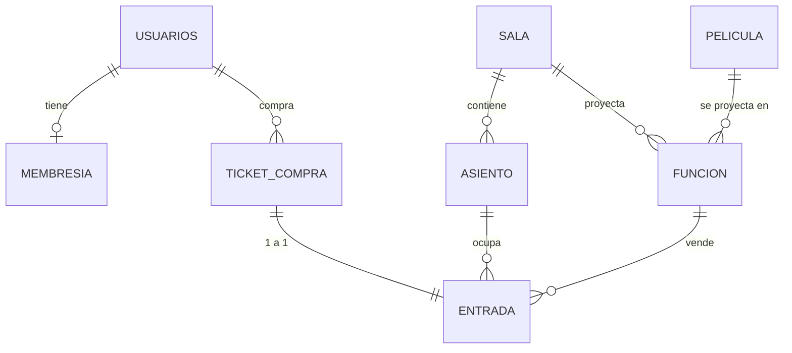

# Auditoría del back-end — GestionDeCine

> Parte 1: estado **inicial** del repositorio (commit `d670bd0`, rama `main`), relevado antes de modificar código.
> Parte 2 (al final): estado **final** después de la rama `mejoras-backend`.

## 1. Entorno y compilación inicial

| Ítem | Valor |
|---|---|
| Build | Maven (wrapper `mvnw`, Maven 3.9.16) |
| Spring Boot | 4.1.1 |
| Java | 25 (JDK 25.0.4 instalado) |
| Base | MySQL 8.0.46 (servicio `MySQL80`) |

Resultado de `./mvnw clean compile` en `main`: **no compilaba**. Había decenas de `cannot find symbol` (`getNombre()`, `getDuracion()`, etc.). Causa: desde Java 23, `javac` ya no ejecuta procesadores de anotaciones que no estén declarados, así que Lombok nunca generaba los getters y setters. Se corrige declarando Lombok en `annotationProcessorPaths` del `maven-compiler-plugin`.

Resultado de `./mvnw test` (con la compilación ya arreglada): **5 tests, 4 con error**.
- `GestionDeCineApplicationTests.contextLoads`: `Found multiple @SpringBootConfiguration annotated classes`. Hay dos clases `@SpringBootApplication` (`EjemploApplication` y `GestionDeCineApplication`).
- `ClienteServiceTest.comprarEntrada_conAsientoLibre_creaElTicket`: `BusinessException: Esta operacion solo esta permitida para clientes`. El usuario de prueba no tiene rol.
- Otros 2 tests de `ClienteServiceTest`: `UnnecessaryStubbing`. Por el mismo motivo, la excepción salta antes de usar los mocks.

## 2. Estructura inicial de paquetes (`com.example.GestionDeCine`)

| Paquete | Contenido |
|---|---|
| raíz | `GestionDeCineApplication` (main), **`EjemploApplication` (main duplicado)**, **`request.http` (archivo de pruebas dentro del código Java)** |
| `controller/` | `Usuario`, `Pelicula`, `Sala`, `Asiento`, `Funcion`, `Cliente`, `MembresiaController` |
| `service/` | Implementaciones: `Usuario`, `Pelicula`, `Sala`, `Asiento`, `Funcion`, `ClienteService` |
| `service/interfaces/` | `IUsuarioService`, `IPeliculaService`, `ISalaService`, `IAsientoService`, `IFuncionService`, `IClienteService` |
| `service/Interface/` | **Duplicado sin uso**: `IAdministrador`, `IClienteService`, `IUsuarioService` |
| `repository/` | 8 interfaces `JpaRepository` |
| `model/` | 8 entidades + 4 enums (`Rol`, `EstadoEntrada`, `FormatoFuncion`, `TipoMembresia`) |
| `dto/` | `CompraRequestDTO`, `LoginRequestDTO`, `UsuarioResponseDTO`, `ErrorResponseDTO` |
| `exception/` | `ResourceNotFoundException`, `BusinessException`, `AutenticacionException`, `GlobalExceptionHandler` |
| Otros | `query tables.sql` (un solo `CREATE TABLE` incompleto, con la FK comentada), `application-h2.properties`, tests con H2 |

## 3. Modelo inicial

- Todas las relaciones son unidireccionales y EAGER (el default de `@ManyToOne` y `@OneToOne`).
- Una compra (`TicketCompra`) tenía exactamente **una** entrada: no se podían comprar varias butacas juntas.
- Las tablas las generaba Hibernate (`ddl-auto=update`). No había un script SQL completo.

## 4. Endpoints iniciales

| Método | Ruta | Request | Response |
|---|---|---|---|
| GET/POST | `/api/usuarios` | entidad `Usuario` | `UsuarioResponseDTO` |
| GET/PUT/DELETE | `/api/usuarios/{id}` | entidad `Usuario` | `UsuarioResponseDTO` / 204 |
| POST | `/api/usuarios/login` | `LoginRequestDTO` | `UsuarioResponseDTO` |
| CRUD | `/api/peliculas`, `/api/salas`, `/api/asientos`, `/api/funciones` | **entidad JPA** | **entidad JPA** |
| GET | `/api/salas/{id}/asientos` | — | `List<Asiento>` |
| GET | `/api/funciones/{id}/asientos-disponibles` | — | `List<Asiento>` |
| GET | `/api/clientes/cartelera` | — | `List<Pelicula>` |
| POST | `/api/clientes/compras` | `{usuarioId, funcionId, asientoId}` | entidad `TicketCompra` |
| GET | `/api/clientes/{usuarioId}/historial` | — | `List<TicketCompra>` |
| GET | `/api/clientes/{usuarioId}/membresia` | — | entidad `Membresia` |
| POST / DELETE | `/api/membresias`, `/api/membresias/{id}` | entidad `Membresia` | entidad / 204 |

## 5. Rúbrica: estado inicial

| # | Requisito | Estado | Evidencia | Qué faltaba |
|---|---|---|---|---|
| 1 | Arquitectura por capas | ⚠️ | Hay paquetes `controller/service/repository/model` | Sobraban el paquete `service/Interface/` y el main duplicado. Faltaban `mapper/` y `config/` |
| 2 | Persistencia SQL (MySQL) | ⚠️ | `application.properties` | El esquema lo inventaba Hibernate (`update`) y no había un script SQL |
| 3 | Entidades del dominio | ⚠️ | `model/` | Una compra no podía tener varias butacas y no existía el estado de una compra |
| 4 | CRUD | ✅ | Controllers de películas, salas, asientos, funciones y usuarios | — |
| 5 | Lógica de negocio | ⚠️ | `ClienteService.comprarEntrada` | Faltaban: funciones superpuestas, funciones ya empezadas, cancelación, total en servidor y concurrencia |
| 6 | Endpoints | ✅ | `controller/` | Faltaban la cancelación, el mapa de butacas y los filtros |
| 7 | Manejo HTTP | ⚠️ | `ResponseEntity` en todos | Se exponían entidades JPA |
| 8 | Validación de entrada | ⚠️ | Bean Validation sobre las entidades | La validación estaba duplicada a mano en los services |
| 9 | Manejo de errores | ⚠️ | `GlobalExceptionHandler` | No cubría tipo de parámetro incorrecto, ruta inexistente ni parámetro faltante, y no logueaba los 500 |
| 10 | Ejecución en localhost | ⚠️ | `server.port=8080` | No compilaba en Java 25. Había una password por defecto commiteada (`admin`) y el puerto era fijo |
| 11 | Documentación de endpoints | ⚠️ | `README.md`, `request.http` | Sin ejemplos de respuesta ni de códigos por endpoint |
| 12 | Separación de responsabilidades | ⚠️ | — | `MembresiaController` accedía directo a los repositorios. Los controllers devolvían entidades |
| 13 | Ejecución en tiempo real | ❌ | — | No compilaba, así que no se podía levantar |

## 6. Bugs, malas prácticas y riesgos (priorizados)

**Críticos**
1. No compila en Java 25 porque Lombok no se procesa (ver §1).
2. Dos `@SpringBootApplication` (`EjemploApplication`) rompen `@SpringBootTest` y la elección de la clase main.
3. Contraseña por defecto de MySQL commiteada (`${DB_PASSWORD:admin}`).
4. Los controllers exponen entidades JPA. Cualquier cambio en la base cambia el JSON, y aparece el riesgo de recursión y de filtrar datos.
5. Doble venta por concurrencia: dos requests simultáneos pueden pasar el chequeo "¿está ocupada?" antes de que alguno guarde.
6. Reglas de negocio faltantes: funciones superpuestas en la misma sala, compra para una función que ya empezó y cancelación.

**Importantes**
7. `MembresiaController` tiene lógica de negocio y usa repositorios directamente.
8. Consultas N+1:
   - `FuncionService.obtenerAsientosDisponibles` hace un `exists` por cada butaca.
   - `AsientoService.existeUbicacionDuplicada` carga todas las butacas de la sala.
9. Validaciones a mano en los services que repiten lo que ya hace Bean Validation.
10. Ids inválidos (`<= 0`) responden 404 con mensajes inconsistentes.
11. Al borrar registros con dependencias, el 409 depende de que la base tire una excepción genérica, con un mensaje poco claro.
12. Precio en `Double`: el dinero con punto flotante tiene errores de redondeo.
13. No hay CORS configurado: el front no podría consumir la API desde otro origen.
14. No hay datos de prueba ni un script SQL del modelo.
15. No se valida que el nombre de sala sea único ni que la sala no tenga más butacas que su capacidad.

**Menores**
16. Métodos sin uso en `UsuarioService`: `crearUsuarioAdministrativo`, `cambiarPassword`, `cambiarRolAdministrativamente`, `tienePermiso`.
17. `EstadoEntrada.DISPONIBLE` nunca se usa.
18. Imports duplicados en `Pelicula`.
19. `request.http` está ubicado dentro del paquete Java.

## 7. Dependencias fuera del stack

| Dependencia | Uso | Decisión |
|---|---|---|
| `com.h2database:h2` | Tests y perfil `h2` | Se quita (el stack es solo MySQL) |
| `com.microsoft.sqlserver:mssql-jdbc` | Ninguno | Se quita |
| `org.projectlombok:lombok` | Entidades y DTOs | **Se mantiene**: se vio en la cursada. Se documenta cada anotación |

## 8. Plan de trabajo (Fase 2)

1. Arreglar la compilación (Lombok en `annotationProcessorPaths`).
2. Limpieza: main duplicado, paquete duplicado, H2/mssql, código muerto.
3. Configuración por variables de entorno, CORS y `ddl-auto=validate`.
4. Base de datos creada por scripts (`database/01_schema.sql`, `database/02_datos.sql`).
5. Nuevo modelo de compra (`TicketCompra` 1→N `Entrada`), relaciones LAZY, `BigDecimal`.
6. DTOs de request/response y mappers. Los controllers dejan de exponer entidades.
7. Reglas de negocio en los services, con `@Transactional` y bloqueo pesimista en la compra.
8. Manejo de errores completo.
9. Tests unitarios (Mockito), test de controller (MockMvc) y `contextLoads` contra MySQL.
10. Verificación con curl, colección Postman y documentación.

---

# Parte 2: estado final (rama `mejoras-backend`)

## Verificación realizada (27/10/2026, MySQL 8.0.46 local)

| Verificación | Resultado |
|---|---|
| `./mvnw clean test` | **20 tests, 0 fallas**: 10 de compra/cancelación, 3 de funciones, 3 de salas (Mockito), 3 de controller (MockMvc) y `contextLoads` con `ddl-auto=validate` contra la base creada por el script |
| `database/01_schema.sql` + `02_datos.sql` con el cliente `mysql.exe` | Sin errores. 4 películas, 2 salas, 70 butacas, 6 funciones, 3 usuarios, 1 membresía |
| Arranque con `validate` | `Started GestionDeCineApplication`: el esquema coincide con las entidades |
| curl a todos los endpoints (casos 200/201/204/400/401/404/405/409) | **97/97** con el código esperado |
| Flujo completo: cartelera → funciones → butacas → comprar → recomprar (409) → cancelar → butaca libre → recomprar (201) | OK |
| 5 compras **simultáneas** de la misma butaca | 1 × 201, 4 × 409. Queda **1** sola entrada en la base |
| Colección Postman ejecutada en orden contra el servidor | **68/68** con el código esperado |

Bugs encontrados durante la verificación y corregidos:
- `isSocio` salía duplicado como `socio` en el JSON.
- Los AUTO_INCREMENT del `INSERT ... SELECT` dejaban huecos en los ids de las butacas de prueba. Ahora se ponen ids explícitos.

## Rúbrica: estado final

| # | Requisito | Estado | Evidencia |
|---|---|---|---|
| 1 | Arquitectura por capas | ✅ | `controller` → `service` (+ `interfaces`) → `repository` → `model`, más `dto`, `mapper`, `exception` y `config`. Ver `ARQUITECTURA.md` |
| 2 | Persistencia SQL (MySQL) | ✅ | `database/01_schema.sql`, `ddl-auto=validate`, `mysql-connector-j` |
| 3 | Entidades del dominio | ✅ | Pelicula, Sala, Asiento, Funcion, Usuario, Membresia, TicketCompra (1→N) Entrada |
| 4 | CRUD | ✅ | GET/POST/PUT/DELETE de películas, salas, butacas, funciones y usuarios; alta y baja de membresías |
| 5 | Lógica de negocio | ✅ | 34 reglas documentadas en `REGLAS_NEGOCIO.md`: superposición, butaca ocupada (con bloqueo), total en servidor, cancelación… |
| 6 | Endpoints para clientes externos | ✅ | 36 endpoints REST en `ENDPOINTS.md` |
| 7 | Manejo de requests/responses HTTP | ✅ | `ResponseEntity` con 200/201/204/400/401/404/405/409/500 y DTOs en todas las respuestas |
| 8 | Validación de entrada | ✅ | Bean Validation en los `*RequestDTO` + `@Valid` en los controllers |
| 9 | Manejo de errores | ✅ | `GlobalExceptionHandler`: formato único, sin stack traces al cliente, log de los 500 |
| 10 | Ejecución en localhost | ✅ | `./mvnw spring-boot:run` → `http://localhost:8080`. Todo configurable por variables de entorno |
| 11 | Documentación de endpoints | ✅ | `ENDPOINTS.md` + colección Postman |
| 12 | Separación negocio / datos / comunicación | ✅ | Los controllers no usan repositorios ni entidades. `MembresiaController` delega en `MembresiaService` |
| 13 | Ejecución en tiempo real | ✅ | Verificado con curl y Postman contra el servidor en ejecución (tabla de arriba) |

## Riesgos y limitaciones que quedan (conocidos y documentados)

- **Sin autenticación real**: cualquiera puede llamar a cualquier endpoint (incluido cancelar compras ajenas), y las passwords están en texto plano. Es una decisión de alcance de la Etapa 1.
- **Fechas relativas**: los datos de prueba tienen funciones a partir de "mañana", así que hay que correr 01 + 02 cerca de la fecha de la demo.
- **`mvn test` necesita MySQL**: el test `contextLoads` valida contra la base real, ya que H2 no está permitido.
- **Commits intermedios**: los commits de modelo, DTO, service y controller de la refactorización no compilan por separado (dependen entre sí); a partir del de tests, todo compila y pasa.
