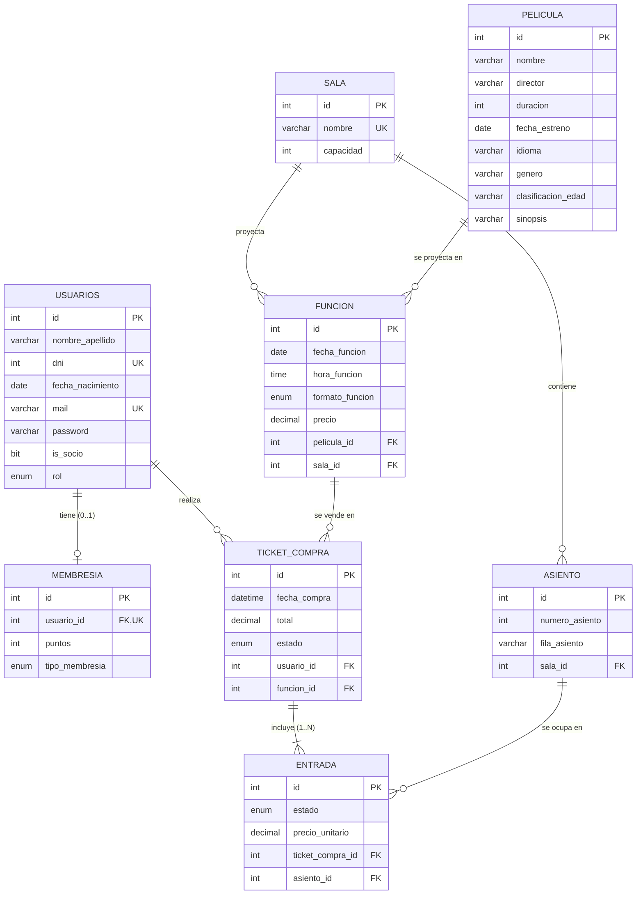

# Modelo de datos

El script completo, con cada restricción comentada, está en [`database/01_schema.sql`](../database/01_schema.sql). Es la "fuente de verdad" del modelo: las clases `@Entity` están escritas para coincidir con él.

## 1. Diagrama entidad-relación

## 2. Tablas y claves primarias

Todas las tablas usan `id INT AUTO_INCREMENT PRIMARY KEY`, mapeado en Java con `@Id @GeneratedValue(strategy = GenerationType.IDENTITY)`.

**¿Por qué una clave subrogada (un número sin significado) y no una "natural" como el mail o el DNI?**
- **No cambia nunca.** El mail de un usuario puede cambiar. Si fuera la PK, habría que actualizar todas las FK que lo referencian.
- **Es chica y rápida.** Un `INT` ocupa 4 bytes y los índices y joins son más rápidos que con un `VARCHAR(100)`.
- **Siempre existe.** Una butaca no tiene un dato natural único por sí sola: "A5" se repite en cada sala.
- **`IDENTITY`** delega la generación en el `AUTO_INCREMENT` de MySQL. Hibernate hace el `INSERT` y lee el id generado.

Los datos que **sí** identifican algo en el negocio van como `UNIQUE`: `usuarios.mail`, `usuarios.dni`, `sala.nombre`, `membresia.usuario_id` y `(asiento.sala_id, fila_asiento, numero_asiento)`.

| Tabla | Entidad | Representa | Claves únicas / CHECK |
|---|---|---|---|
| `usuarios` | `Usuario` | Persona con acceso (cliente, empleado, admin) | UNIQUE `mail`, UNIQUE `dni`, CHECK `dni > 0` |
| `membresia` | `Membresia` | Programa de socios | UNIQUE `usuario_id` (es lo que hace la relación 1 a 1), CHECK `puntos >= 0` |
| `pelicula` | `Pelicula` | Película del catálogo | CHECK `duracion > 0` |
| `sala` | `Sala` | Sala física | UNIQUE `nombre`, CHECK `capacidad > 0` |
| `asiento` | `Asiento` | Butaca física de una sala | UNIQUE `(sala_id, fila_asiento, numero_asiento)`, CHECK `numero_asiento > 0` |
| `funcion` | `Funcion` | Proyección: película + sala + fecha/hora + precio | CHECK `precio > 0` |
| `ticket_compra` | `TicketCompra` | Una compra de un usuario para una función | CHECK `total > 0` |
| `entrada` | `Entrada` | Una butaca dentro de una compra | CHECK `precio_unitario > 0` |

**Tipos de datos elegidos:**
- `DECIMAL(10,2)` para dinero (en Java `BigDecimal`). Es exacto: `0.1 + 0.2` da `0.3`, cosa que con `DOUBLE` no pasa.
- `ENUM(...)` para los enums de Java (`@Enumerated(EnumType.STRING)`). La base solo acepta los valores válidos y se guarda el nombre (`'CONFIRMADA'`), no un número, así que agregar un valor nuevo al enum no corrompe los datos.
- `BIT(1)` para el boolean `is_socio`, que es el tipo que espera Hibernate para `boolean` en MySQL.
- `DATE` y `TIME` separados en `funcion` (`LocalDate` y `LocalTime`), y `DATETIME(6)` para `fecha_compra` (`LocalDateTime`, con microsegundos).

## 3. Relaciones y su anotación JPA

| Relación | Cardinalidad | Lado dueño (tiene la FK) | Anotación |
|---|---|---|---|
| Sala → Asiento | 1 a N | `Asiento.sala` | `@ManyToOne(fetch = LAZY, optional = false) @JoinColumn(name = "sala_id")` |
| Pelicula → Funcion | 1 a N | `Funcion.pelicula` | `@ManyToOne(fetch = LAZY) @JoinColumn(name = "pelicula_id")` |
| Sala → Funcion | 1 a N | `Funcion.sala` | `@ManyToOne(fetch = LAZY) @JoinColumn(name = "sala_id")` |
| Usuario → Membresia | 1 a 0..1 | `Membresia.usuario` | `@OneToOne(fetch = LAZY) @JoinColumn(name = "usuario_id", unique = true)` |
| Usuario → TicketCompra | 1 a N | `TicketCompra.usuario` | `@ManyToOne(fetch = LAZY) @JoinColumn(name = "usuario_id")` |
| Funcion → TicketCompra | 1 a N | `TicketCompra.funcion` | `@ManyToOne(fetch = LAZY) @JoinColumn(name = "funcion_id")` |
| TicketCompra → Entrada | 1 a N (**bidireccional**) | `Entrada.ticketCompra` | En `Entrada`: `@ManyToOne @JoinColumn(name = "ticket_compra_id")`. En `TicketCompra`: `@OneToMany(mappedBy = "ticketCompra", cascade = ALL) List<Entrada> entradas` |
| Asiento → Entrada | 1 a N | `Entrada.asiento` | `@ManyToOne(fetch = LAZY) @JoinColumn(name = "asiento_id")` |

**Lado dueño:** en una relación JPA, el lado "dueño" es la entidad cuya tabla tiene la columna FK, y es la que lleva `@JoinColumn`. En la relación bidireccional, el otro lado (`TicketCompra.entradas`) usa `mappedBy = "ticketCompra"` para decir "esta relación ya está mapeada por el campo `ticketCompra` de `Entrada`; no crees otra columna ni otra tabla".

**¿Por qué casi todas son unidireccionales?** `Sala` no tiene una `List<Asiento>`, `Pelicula` no tiene una `List<Funcion>`, etc. Las listas solo se agregan donde se usan. Para "las butacas de una sala" se consulta `AsientoRepository.findBySalaId…`. La única bidireccional es `TicketCompra.entradas`, porque una compra siempre se muestra con sus entradas y las entradas se crean junto con la compra.

**¿Por qué `entrada` no tiene `funcion_id`?** La función ya está en su ticket (`entrada → ticket_compra → funcion`). Repetirla sería redundante (podría quedar inconsistente: una entrada de la función 1 dentro de un ticket de la función 2). Es una decisión de **normalización**.

## 4. Fetch, cascadas y borrado

### `FetchType.LAZY` en todas las asociaciones
Por defecto `@ManyToOne` y `@OneToOne` son **EAGER**: cargar una `Entrada` traería su ticket, la función, la película, la sala, el usuario… en cada consulta. Con **LAZY**, Hibernate pone un *proxy* y la consulta se hace solo si el código accede a ese dato. Las consultas que sí necesitan los datos relacionados los traen juntos de forma explícita, para evitar el problema **N+1**:
- `FuncionRepository.buscar` usa `join fetch f.pelicula join fetch f.sala`: una sola consulta para listar funciones con sus nombres.
- `TicketCompraRepository.findByUsuarioIdOrderByFechaCompraDesc` usa `@EntityGraph(attributePaths = {"funcion.pelicula", "funcion.sala", "entradas.asiento"})`: el historial sale en una consulta.
- `EntradaRepository.findAsientoIdsByFuncionIdAndEstado` trae todos los ids ocupados de una función en una consulta, en vez de preguntar butaca por butaca.

Con `spring.jpa.open-in-view=false`, la sesión de Hibernate se cierra al salir del service. Por eso los services devuelven **DTOs ya armados** dentro de la transacción y ningún acceso LAZY "se escapa" al controller.

### Cascadas
- **JPA:** solo `TicketCompra.entradas` tiene `cascade = CascadeType.ALL`. Una entrada nace con su compra y no existe sin ella. Con la cascada, `ticketCompraRepository.save(ticket)` inserta el ticket y todas sus entradas en la misma transacción. En ninguna otra relación hay cascada: por ejemplo, borrar una `Sala` **no** debe borrar sus butacas y funciones "sin querer".
- **Base de datos (`ON DELETE`):**

| FK | ON DELETE | Qué pasa al borrar el registro padre |
|---|---|---|
| `membresia.usuario_id → usuarios` | **CASCADE** | Al borrar un usuario, la base borra su membresía (no tiene sentido sin él) |
| `entrada.ticket_compra_id → ticket_compra` | **CASCADE** | Al borrar un ticket se borran sus entradas. La API nunca borra tickets (los cancela), pero el modelo queda coherente |
| `asiento.sala_id → sala` | RESTRICT | No se puede borrar una sala con butacas |
| `funcion.pelicula_id → pelicula` | RESTRICT | No se puede borrar una película con funciones |
| `funcion.sala_id → sala` | RESTRICT | No se puede borrar una sala con funciones |
| `ticket_compra.usuario_id → usuarios` | RESTRICT | No se puede borrar un usuario con compras |
| `ticket_compra.funcion_id → funcion` | RESTRICT | No se puede borrar una función con compras |
| `entrada.asiento_id → asiento` | RESTRICT | No se puede borrar una butaca ya vendida |

### Qué devuelve la API al borrar cada cosa

| DELETE de… | Si no tiene dependencias | Si tiene dependencias |
|---|---|---|
| Película | 204 | 409 "tiene funciones asociadas" |
| Sala | 204 | 409 "tiene butacas o funciones asociadas" |
| Butaca | 204 | 409 "tiene entradas vendidas" |
| Función | 204 | 409 "ya tiene compras" |
| Usuario | 204 (y su membresía se borra en cascada) | 409 "tiene compras registradas" |
| Membresía | 204 (el usuario deja de ser socio) | — |
| Compra | No se borra: `PATCH /api/clientes/compras/{id}/cancelar` | — |

**Decisión: 409 en lugar de baja lógica.** Una alternativa era agregar una columna `activo` y "desactivar" en vez de borrar. Se eligió responder 409 porque es más simple, no obliga a filtrar `activo = true` en cada consulta y protege el historial de ventas igual. Las compras sí tienen "baja lógica" a través de su `estado` (CANCELADA), porque se necesita conservar el historial.

## 5. Quién crea las tablas: validate vs update vs create

`spring.jpa.hibernate.ddl-auto` le dice a Hibernate qué hacer con el esquema al arrancar:

| Valor | Qué hace | Riesgo |
|---|---|---|
| `create` | Borra todas las tablas y las crea de nuevo a partir de las `@Entity` | Se pierden todos los datos en cada arranque |
| `create-drop` | Igual que `create`, y además las borra al apagar la app | Lo mismo; solo sirve para pruebas descartables |
| `update` | Compara las entidades con la base y **agrega** lo que falta (tablas, columnas). No borra ni modifica columnas existentes | Cambios silenciosos e incompletos: renombrar un campo deja la columna vieja y crea una nueva; los `CHECK`, los `ON DELETE` y los nombres de las restricciones quedan como Hibernate decide |
| **`validate`** (el que usamos) | **No toca nada.** Verifica que cada tabla y columna que piden las entidades exista con un tipo compatible. Si no, la app no arranca | Ninguno sobre los datos. Obliga a que el script y las entidades estén sincronizados |
| `none` | No hace nada ni valida | No se detecta si el código y la base no coinciden |

**¿Por qué crear la base con scripts SQL?**
1. **Lo pide la cátedra:** el modelo SQL se diseña y se explica como SQL (PK, FK, `ON DELETE`, `CHECK`), no se "descubre" en lo que generó Hibernate.
2. **Control total:** el script define cosas que `update` no hace bien o no hace: `CHECK (precio > 0)`, `ON DELETE CASCADE` en membresía, nombres de restricción legibles (`fk_funcion_sala`) y el `DROP DATABASE` para resetear.
3. **Separación de responsabilidades:** la base la administra MySQL; la aplicación solo la usa. Es lo habitual en un sistema real, donde el usuario de la app ni siquiera tiene permiso de `CREATE TABLE`.
4. **Reproducible:** cualquier integrante corre `01` + `02` y tiene exactamente la misma base y los mismos datos.
5. **`validate` es una red de seguridad:** si alguien cambia una entidad y no el script (o al revés), el error aparece al arrancar y no en medio de la demo. Lo mismo hace el test `GestionDeCineApplicationTests.contextLoads`.

## 6. ¿Dónde se hace realmente la persistencia?

En **MySQL**. El recorrido de un `save` es:
1. El service llama a `ticketCompraRepository.save(ticket)`.
2. Spring Data JPA (el proxy que implementa la interfaz) llama a `EntityManager.persist`.
3. Hibernate (el ORM) traduce eso a `INSERT INTO ticket_compra (...) VALUES (?, ...)` y, por la cascada, a un `INSERT INTO entrada ...` por cada entrada.
4. El driver JDBC `mysql-connector-j` envía el SQL a MySQL por TCP (puerto 3306).
5. Al terminar el método `@Transactional` se hace el **COMMIT** y recién ahí los datos quedan guardados en disco.

Con `SHOW_SQL=true` (el default) se ve en la consola cada SQL que genera Hibernate.
